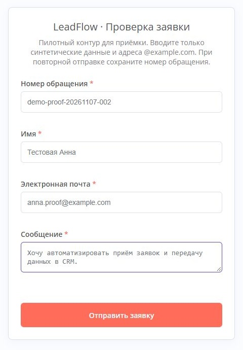
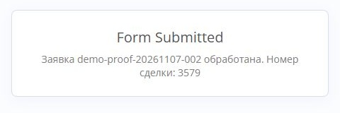
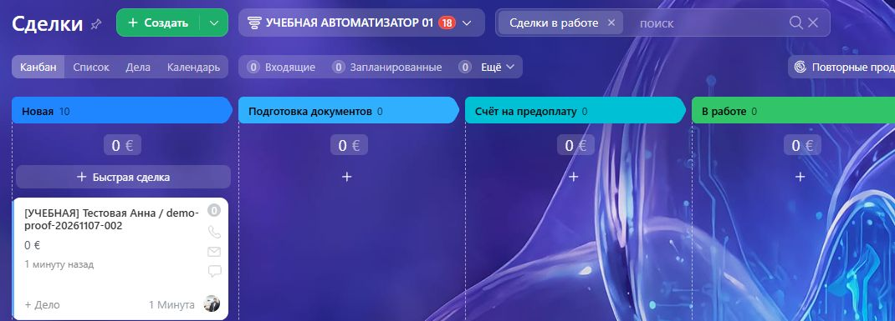
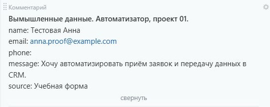
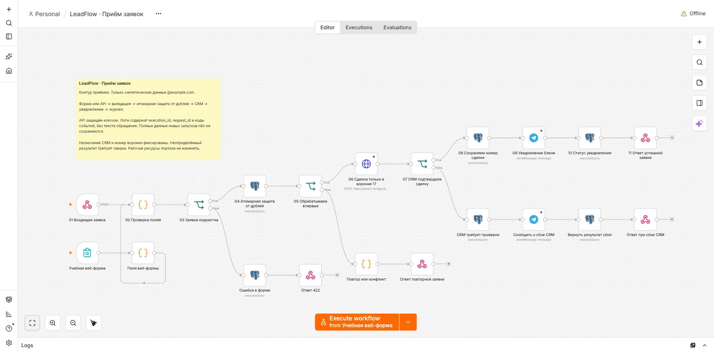

# LeadFlow

Автоматизация приёма обращений из формы в Bitrix24 с уведомлениями Telegram, отчётностью и журналом обработки.

Решение регистрирует заявку, проверяет поля и создаёт сделку в выделенной воронке. Повторная отправка того же обращения возвращает сохранённый результат. Неопределённый ответ CRM переводит заявку на ручную сверку, без слепого повторного создания.

[Открыть работающую форму пилота](https://n8n.fghk.ru/form/auto01-leadflow-demo). Используйте только вымышленные данные @example.com.

## Проверка от заполненной формы до сделки

Визуальный прогон от 7 ноября 2026 года: обращение `demo-proof-20261107-002`, сделка **3579**. Использованы вымышленные данные. На снимках CRM нет URL портала, адресной строки и посторонних клиентских записей.

### 1 Заполненная форма

Имя: **Тестовая Анна**. Почта: **anna.proof@example.com**. Сообщение: «Хочу автоматизировать приём заявок и передачу данных в CRM.»



### 2 Подтверждение отправки



### 3 Обращение в выделенной воронке



### 4 Данные внутри сделки



Данные находятся в комментарии сделки. Стандартные EMAIL/PHONE контакта не заполняются; новый контакт не создаётся. В качестве CRM-сущности выбрана сделка в отдельной воронке, а не глобальный лид.

## Как устроено решение

Форма или авторизованный API → валидация → атомарная регистрация request_id в PostgreSQL → ограниченный CRM-адаптер → сделка Bitrix24 → Telegram → состояние и ответ источнику.



| Компонент | Назначение |
|---|---|
| n8n | Приём, маршрутизация, интеграции и расписание |
| PostgreSQL | Канонические заявки, защита от дублей, audit и агрегаты |
| Bitrix24 | Сделки в отдельной категории 17 |
| Telegram | Уведомления, аварийные сообщения и отчёт |
| Python-адаптер | Фиксированный портал, категория и допустимые REST-действия |

## Документация

- [Руководство PDF с оглавлением и страницами](docs/LeadFlow_Руководство.pdf)
- [Редактируемая версия Word](docs/LeadFlow_Руководство.docx)
- [Исходные протоколы проверок](evidence/protocols)
- [SQL-шаблон отчёта](sql/report_template.sql)
- [Скриншоты](evidence/screenshots)

Руководство разделяет пользовательскую и техническую части: паспорт, инструкции, маппинг, диагностика, восстановление, безопасность, поддержка и приёмка. JSON нужны для технической проверки; основные результаты изложены в руководстве и таблице ниже.

## Что проверено

| Проверка | Результат | Подтверждение |
|---|---|---|
| Приём, валидация, повтор, конфликт, пять конкурентных отправок | 8 из 8 | [Функциональный прогон](evidence/protocols/acceptance-result.json) |
| API-ключ, фиксированная воронка, минимальный аудит, обработчик ошибки | 10 из 10 | [Протокол безопасности](evidence/protocols/security-protocol.json) |
| Недоступность собственного адаптера | Заявка сохранена в crm_review, слепого повторного create нет | [Проверка отказа](evidence/protocols/fault-result.json) |
| Восстановление собственной БД в отдельную базу | requests, events и audit совпали по числу строк и контрольным суммам | [Проверка копии](evidence/protocols/restore.json) |
| Логика CRM-адаптера с подменённым upstream | 6 из 6 | [Модульный протокол](evidence/protocols/bridge-unit-tests.log) |
| Заполненная форма и данные в CRM | Сделка 3579, значения совпали | [Браузерный прогон](evidence/protocols/ui-proof-3579.json) |

Таблицы руководства и машинные протоколы фиксируют более ранний контрольный срез. Скриншоты сделки 3579 подтверждают отдельный последующий прогон. Пентест, производственная нагрузка и пользовательская приёмка не заявляются выполненными.

## Импорт и настройка

1. Развернуть n8n и отдельную PostgreSQL-базу/роль для решения. Применить `sql/schema.sql` и `sql/hardening.sql` только к своей базе.
2. Настроить выделенную CRM-воронку. В `src/bridge.py` заменить пример портала и проверить ограничения категории/пользователя/стадии до первого запроса. Значения должны совпадать с согласованной воронкой.
3. Собрать адаптер из `src/Dockerfile`. Подключить к внутренней сети n8n, без опубликованных портов; использовать read-only rootfs, cap_drop ALL, no-new-privileges и ограничение памяти.
4. Импортировать три JSON из `workflows`. Экспорты намеренно выключены; credentials содержат заглушки. Назначить собственные PostgreSQL, Telegram, CRM-header и входной API-ключ. Настроить chat ID, домены и таймауты.
5. Опубликовать обработчик ошибок, затем основной процесс и отчёт. В установленной среде n8n 2.37.10 обработчик требовал публикации; фактический вызов проверен контролируемой ошибкой.
6. Выполнить синтетический прогон и сверить одну запись БД, одну сделку и подтверждённое уведомление. Доступные публике шаблоны не содержат работающих ключей или частных адресов развернутой системы.

Для модульной проверки адаптера из корня репозитория:

```console
python -m unittest discover -s src -p "test_*.py" -v
```

Тесты используют подмену CRM-вызовов, не создают записи в реальном портале.

## Безопасность и рабочий запуск

В проверенном пилоте API защищён отдельным заголовком, секреты хранятся в credentials, аудит не содержит содержимого обращения или ключей. Каноническое тело сохраняется в requests. Отключение обычного сохранения payload в n8n не означает мгновенное физическое удаление: pruning отложен.

Перед приёмом реальных обращений нужны защита публичной формы от злоупотреблений, минимальные права CRM, согласованные сроки хранения, регулярное внешнее резервирование, назначенные владельцы и поддержка. Общий CRM scope шире ограничений адаптера. Отдельные Dev/Test/Prod и выделенный Telegram-доступ в пилоте полностью не реализованы. Готовность к промышленному запуску не заявляется.

В репозиторий не включены ключи, runtime.json, приватные дампы и внутренние административные скрипты. Адреса инфраструктуры и служебные идентификаторы доступа заменены примерами. Скриншоты показывают только вымышленные обращения.
